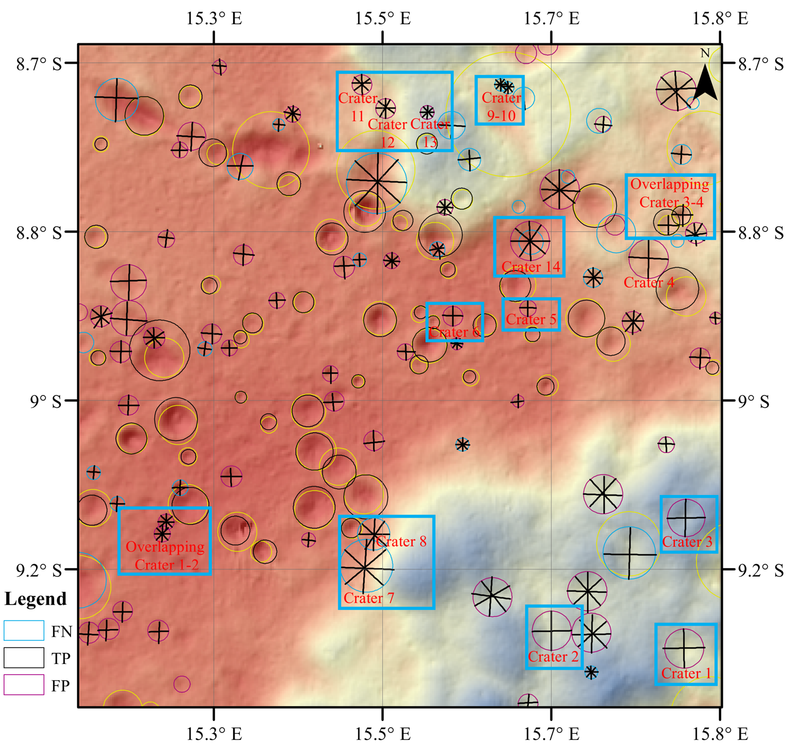

# Apollo 16 portable ArcMap package

[Project, DEMs and profile images](Apollo16_project_and_profiles_20261125.zip) · [Liu reference layer](Apollo16_Liu_reference_20261125.zip) · [Other referenced catalog layers](Apollo16_other_reference_layers_20261125.zip) · [中文说明](README_zh-CN.md)

Download **all three archives** and extract them into the **same parent directory**, merging the `Apollo16_ArcMap` folders. Each archive contains different files. Then open the desired `.mxd` in **ArcMap 10.8**. Maps use relative paths; GIS data and supplied case images are included. Reviewer letters and manuscript files are excluded.

- **`Apollo16_marked_cases.mxd`**: author annotations, numbered cases and profile locations; historical center-based overlays are preserved.
- **`Apollo16_catalog_comparison_80pct.mxd`**: uniform 80% area-retention comparison, with 109 predictions and 82 references (52 TP, 57 FP, 30 FN).
- **`Apollo16_original_context.mxd`**: original context and all originally referenced catalog layers.

Use `data/rasters/Apollo16_elevation_m.tif` for physical elevations; its original encoded raster has a 0.5 scale factor. The metre version already applies that conversion. 3D Analyst is required for the ArcMap interpolated-line/profile-graph tools, but not for opening the maps or viewing supplied images.

All opening steps, dataset provenance, footprint/matching rules, interpretation notes and file checksums are inside the ZIP. The adjacent full instructions reproduce the package README. The main CE-5 branch remains unchanged.

---

# Apollo 16 ArcMap project and crater interpretation data

This package preserves the supplied ArcMap workspace, its annotated case locations, every referenced GIS dataset, and the supplied profile-panel images. No reviewer letters or manuscript files are included. All three MXD documents use relative data paths.

## Open the maps

1. Download **all three ZIP files**: `Apollo16_project_and_profiles_20261125.zip`, `Apollo16_Liu_reference_20261125.zip`, and `Apollo16_other_reference_layers_20261125.zip`. Extract each into the **same parent folder**. They contribute non-overlapping files to one `Apollo16_ArcMap` folder; merge the directories when prompted. Do not open an MXD inside a ZIP or copy it away from its accompanying `data` folder.
2. Use **ArcMap 10.8** (the version used for validation). Opening the maps does not require a Python installation. Other ArcMap versions have not been tested; QGIS cannot directly open MXD files, but can read the supplied SHP and GeoTIFF datasets.
3. Open one of the documents in the extracted `Apollo16_ArcMap` folder:

| Document | Purpose |
| --- | --- |
| `Apollo16_marked_cases.mxd` | Preserves the author's numbered cases, graphic transects, symbology and historical map layers. Best starting point for locating the illustrated cases. |
| `Apollo16_catalog_comparison_80pct.mxd` | Recommended map for the uniform 80% footprint comparison: 52 TP, 57 FP and 30 FN. Profile-review layers and the elevation-in-metres raster are supplied as optional, initially hidden layers. |
| `Apollo16_original_context.mxd` | Preserves the unmarked workspace, including its originally hidden Liu, Wang and Zhang catalog layers. |

The marked and original-context maps preserve their historical center-based overlays (52 TP, 60 FP, 31 FN); those overlays are **not** the 80% comparison. The wider yellow detection layer contains 244 diameter-filtered predictions before selection by the common comparison footprint. Use the dedicated 80% map and `data/catalog_comparison_80pct` for the reported comparison. Graphic labels and transects in the marked map are map annotations, not automatically classified GIS features.

## Package contents

| Folder/file | Contents |
| --- | --- |
| `data/rasters` | Original encoded SLDEM2015 crop, an elevation-in-metres GeoTIFF, a portable hillshade, and DEM metadata. |
| `data/detections` | The source diameter-filtered detection layer (244 features) referenced by the maps. |
| `data/catalogs` | All three originally referenced regional catalog layers, including the originally hidden layers. They remain separate sources. |
| `data/historical_center_only` | Original coverage, TP-reference, FP-prediction and FN-reference layers used in the historical maps. |
| `data/catalog_comparison_80pct` | Uniform-footprint comparison layers, matches, record tables, boundary audits and benchmark metadata. |
| `data/profile_review` | Author-recorded profile support and unresolved-target observations, supplied separately from the catalog comparison. |
| `images` | Case-location overview, Craters 1–14, four overlapping-crater panels and map previews. |
| `map_layers.json` | Relative source paths, layer visibility and feature counts for each map. |
| `portability_check.json` | Results of reopening a relocated copy of all three MXD documents. |
| `SHA256SUMS.txt` | SHA-256 hashes of the released files. |
| `README_zh-CN.md` | Chinese opening and profile-extraction instructions. |

Keep all same-stem `.shp`, `.shx`, `.dbf`, `.prj` and `.cpg` files together. Temporary lock files, machine-wide geodatabases, cached credentials, detection source code and reviewer documents are excluded.

## Inspect elevations and extract profiles

1. Locate a case in `Apollo16_marked_cases.mxd`, using the visible case labels or `images/case_locations_annotated.png`.
2. For **physical elevations in metres**, add `data/rasters/Apollo16_elevation_m.tif`, or select the initially hidden `Elevation_m_for_profiles` layer in the 80% map. The original `Apollo16_SLDEM2015_encoded.tif` stores integer samples with scale **0.5** and offset **0**. The metre raster has that scaling already applied; do not multiply it by 0.5 again. Existing author-supplied profile screenshots are preserved as illustrations and their vertical labels have not been recalculated.
3. If available, enable the **3D Analyst** extension and toolbar. Choose the metre raster as the surface, use **Interpolate Line** to draw a transect through the target, then **Profile Graph**. Repeat along N–S, E–W and the two diagonals. These tools require the corresponding ArcGIS extension; map viewing and the supplied PNG panels do not.
4. The black lines saved in the marked layout indicate the author's examined directions. Draw new transects in the data view or work with saved line features to generate new profiles. A screenshot itself is not a measurement layer or an elevation table.
5. Compare central depressions, bounding relief and directional continuity, considering the regional slope and neighboring structures. Retain ambiguous interpretations as such. Newly drawn transects need not reproduce the original screenshots exactly because placement, interpolation and sampling can differ.

The crop is 615 × 462 pixels at approximately 59.2253 m spacing. Its coordinate system is lunar equidistant cylindrical, radius 1,737,400 m, central meridian 0 degrees and standard parallel 0 degrees, with projected coordinates in metres. It is **not Earth WGS84**. Full WKT and the pixel-aligned extent are in `data/rasters/dem_metadata.json`.

## Catalog comparison and interpretation

For both predictions and references, retain full footprints with at least 80% of their area inside the supplied common coverage. The diameter interval is 350–1817.4 m. Compute polygon IoU on the **full, unclipped polygons**, retain candidate pairs with **IoU strictly greater than 0.4**, then greedily assign pairs in descending IoU with each prediction/reference used at most once. The released benchmark has 109 predictions, 82 references, TP=52, FP=57 and FN=30; precision, recall and F1 are 47.71%, 63.41% and 54.45%.

The 36 profile-supported unmatched predictions are author observations, not extra catalog matches. Together with the 52 matches they give 88/109 predictions with catalog or profile support; this proportion is not an independent precision estimate. Historical review filenames containing `TP` or `rejected` identify the saved selections; they do not establish an independently corrected reference catalog. For the four examined reference targets, the current DEM profiles do not consistently express a central depression and bounding rims; this is not proof that those targets are not impact craters.

The preserved images illustrate: Craters 1–6, profile-supported unmatched predictions; Craters 7–10, unmatched reference targets; Craters 11–14, unresolved candidates with directionally variable morphology; and Overlapping Craters 1–4, two partially overlapping pairs. For Overlapping Craters 3–4, yellow outlines are predictions and black outlines are Liu reference features. Case numbers in images are display labels, not necessarily GIS record IDs. Cases 1–14 have not all been linked to unique database IDs in this release; locate them through the marked map rather than inferring IDs from the labels. The corrected lower-left labels in Crater 13 and 14 are the only edits to those two supplied panels.

## Sources and attribution

These are regional derivatives and interpretation records, not a replacement for the source catalogs. Cite the appropriate original dataset and paper when reusing third-party layers; their source terms remain applicable.

- **SLDEM2015:** SELENE/Kaguya terrain camera and LRO LOLA merged lunar topography; the original encoded crop is preserved without resampling. See Barker et al., *Icarus*, 273, 346–355, 2016, doi: [10.1016/j.icarus.2015.07.039](https://doi.org/10.1016/j.icarus.2015.07.039).
- **Liu et al. (2026):** LROC NAC-based landing-region crater catalog. Dataset doi: [10.12176/03.05.00008-V01](https://doi.org/10.12176/03.05.00008-V01); paper doi: [10.11728/cjss2026.03.2025-0135](https://doi.org/10.11728/cjss2026.03.2025-0135). The source data-center metadata specifies CC BY 4.0. Original identifiers and polygon boundaries are retained after reprojection.
- **Wang et al. (2021):** doi: [10.1029/2020JE006728](https://doi.org/10.1029/2020JE006728); dataset [Zenodo 4983248](https://zenodo.org/records/4983248). The regional layer represents centers and diameters as 72-segment lunar geodesic circles, not independently traced rims. Its nominal lower diameter is 1 km.
- **Zhang et al. (2026):** regional source [Zenodo 21670244](https://zenodo.org/records/21670244). Original polygons were reprojected into the DEM coordinate system. Its observational coverage differs from the Liu comparison footprint; absence of a record outside its valid coverage must not be read as a false detection.

## Troubleshooting

- A red exclamation mark beside a layer usually means the package was incompletely extracted or its internal folders were moved. Restore the original folder structure and reopen the MXD. `map_layers.json` lists the expected relative source for every layer.
- Use the **data view** to navigate and query layers and the **layout view** for saved labels and page graphics. Text appearance may vary when fonts installed on another computer differ.
- No NAC image mosaic is embedded: the supplied visual background is SLDEM2015 and its hillshade; “NAC-based” describes the source of the Liu crater annotations.
- Packaging validation tests local relocation and source integrity. It does not remove the subjectivity of crater interpretation or create new independent highland accuracy validation.
